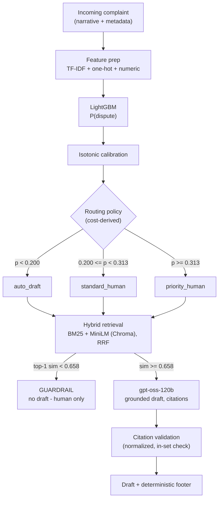

# ticket-triage

ML triage + RAG response drafting for consumer-finance support desks — calibrated dispute-risk routing, hybrid retrieval, grounded LLM drafts with citations, and confidence-based human escalation.


---

## Why This Exists

Support teams at consumer-finance companies face a routing problem: most complaints are routine, but a meaningful fraction end in consumer disputes — and mishandled disputes are expensive. This project builds a complete copilot around that reality:

- **Risk scoring** — a calibrated model predicts the probability that a complaint will end in a dispute
- **Routing** — business-cost arithmetic converts that probability into a three-way decision: `auto_draft` / `standard_human` / `priority_human`
- **Grounded drafting** — hybrid retrieval (BM25 + dense embeddings, RRF-fused) fetches similar past cases; an LLM drafts a reply that cites them
- **Guardrails** — a similarity threshold blocks drafting when retrieval has no good precedent; citations are programmatically validated

**Design thesis:** a moderately accurate model (ROC-AUC ≈ 0.62) is still useful if its uncertainty is handled honestly. Calibration, cost-derived thresholds, and a low-confidence guardrail decide when automation is safe — the model is never trusted blindly.

---

## Headline Results

| Result | Value |
|--------|-------|
| Complaints auto-drafted | 48.9% of volume |
| Dispute rate among auto-drafted | 11.3% vs 16.3% baseline (−31% relative) |
| Priority queue | 11.1% of volume, 1.74× dispute enrichment, captures 19.3% of all disputes |
| Cost per complaint | −18.1% vs all-human baseline (illustrative costs) |
| Draft faithfulness (LLM-judged) | 0.546 → 0.875 after failure-driven redesign |
| Citation validity | 83% → 100% |
| End-to-end API latency | ~1–2.5 s including the LLM call |

---

## Live Routing Demo

Same API, three complaints, three decisions — the calibrated risk decides the workflow:

| Complaint | Risk | Route |
|-----------|------|-------|
| Debt-collection calls, no written validation | 0.192 | `auto_draft` |
| Credit-bureau dispute, verification details withheld | 0.262 | `standard_human` |
| Broker closed unauthorized-transaction disputes without investigation | 0.485 | `priority_human` |

---

## Architecture



**Drafting ≠ sending.** Every route can request a draft as a suggestion for the agent; only `auto_draft` represents complaints low-risk enough to send with light review. The API returns risk + route + draft together and leaves the send-policy to the client.

---

## Data: Three Datasets Auditioned, Two Rejected

The most valuable early work was proving the data was trustworthy before building on it:

| Dataset | Verdict | Evidence |
|---------|---------|----------|
| Kaggle "Customer Support Tickets" (synthetic) | Rejected | Labels provably random — 5-fold text classifier at chance (0.244 vs 0.259); 100% of rows contain unfilled `{product_purchased}` template placeholders |
| CFPB official export (current) | Rejected | Consumer narratives removed from the public database in 2025 — no text column exists |
| CFPB Kaggle mirror (pre-2025 snapshot) | Accepted | 1.28M rows, 383k narratives, dispute labels present, schema verified by script |

**Final working set:** 160,982 complaints (deduplicated) with narratives and dispute outcomes, split temporally — train Mar 2015 → Jan 2017 (136,835), test Jan → Apr 2017 (24,147). Temporal, not random: complaint distributions drift, and random splits flatter models that would fail in production.

**Two structural rules enforced throughout:**

- **Leakage quarantine** — `company_response_to_consumer` is known only after resolution. It is stored for the RAG corpus but excluded from classifier features.
- **Retrieval corpus is train-period only** — the RAG layer never sees test-period complaints. Retrieval leakage is just as real as feature leakage.

---

## ML Evaluation

Candidates compared on a held-out temporal calibration slice (late 2016); the 2017 test set was touched exactly once, for final reporting.

| Model (calibration slice) | ROC-AUC | PR-AUC | Fit time |
|---------------------------|---------|--------|----------|
| TF-IDF + LogReg (text only) | 0.620* | 0.320* | 62 s |
| + structured features (LogReg) | 0.638 | 0.320 | 62 s |
| LightGBM + structured (final) | 0.642 | 0.324 | 253 s |

*text-only row measured on the 2017 holdout in the baseline step; see `evaluation/*.json` for exact protocols.*

Final model on the 2017 holdout: ROC-AUC 0.624, PR-AUC 0.235 (1.44× lift over the 16.3% base rate). The LogReg/LightGBM gap is inside noise — either is defensible; LightGBM won both ranking metrics on the selection slice, LogReg retrains 4× cheaper.

**Calibration** (isotonic, fitted on the calibration slice):

| | Brier ↓ | ECE ↓ |
|---|---------|-------|
| Raw LightGBM | 0.1389 | 0.0664 |
| + isotonic | 0.1355 | 0.0468 |

ECE doesn't reach zero for a documented reason: dispute prevalence drifted 20.9% → 16.3% between the calibration and test periods, so a calibrator fitted on late-2016 data over-predicts in 2017. The error direction is conservative — the system auto-drafts slightly less than optimal, never more. Production answer: rolling recalibration (see Production Notes).

---

## Routing Policy

Thresholds come from business arithmetic, not grid search:

- `auto_draft` when P(dispute) < C_human / C_dispute = $15 / $75 = 0.20
- `priority_human` for the top decile of risk (percentile threshold — robust to prevalence drift, unlike a fixed probability)

| Tier | Volume | Actual dispute rate |
|------|--------|---------------------|
| auto_draft (p < 0.200) | 48.9% | 11.3% |
| standard_human | 40.1% | 19.0% |
| priority_human (p ≥ 0.313) | 11.1% | 28.4% (1.74× base) |
| all complaints | 100% | 16.3% |

The cost sweep shows the test-set minimum at t = 0.25 — deliberately not adopted: choosing an operating point by looking at the test set is exactly the leakage this project avoids. The reported operating point (0.20) was fixed blind, from costs. Cost assumptions are illustrative and stated in `evaluation/routing_config.json`.

---

## Retrieval (RAG)

20,000 train-period complaints embedded with `all-MiniLM-L6-v2` (384-d) into a local Chroma index; hybrid search fuses BM25 and dense results with Reciprocal Rank Fusion.

| Method | Product-match@5 (200 test queries) |
|--------|-------------------------------------|
| Dense (MiniLM) | 0.677 |
| BM25 | 0.508 |
| Hybrid (RRF) | 0.699 |

BM25's weakness here is structural: CFPB redacts entities to `XXXX`, so exact-token matching collapses when every company name is the same token — a clean demonstration of when semantic search earns its keep.

A guardrail blocks drafting when top-1 similarity < 0.658 (10th percentile of calibration-query similarity): ~10% of complaints get no draft and go straight to a human.

---

## LLM Drafting & the Evaluation Loop

Drafts come from `gpt-oss-120b` (Groq free tier) behind a runtime model resolver — hosted providers deprecate models without notice (Groq retired its entire Llama lineup mid-project; the resolver failed loudly with the available-model list instead of a cryptic 404).

**v1 failed its own evaluation.** An LLM-as-judge harness (faithfulness = share of factual claims traceable to provided context) scored RAG drafts at 0.546 — worse than no-RAG. Failure analysis (script 13b) found four causes:

1. Invented SLAs — "within 2–3 business days"; no service-level agreement was ever provided
2. Parametric legal claims — an FDCPA paragraph from model memory, subtly imprecise
3. Unauthorized commitments — "we will place a fraud alert"
4. A parser bug (mine) — citations "failing" validation due to Unicode non-breaking hyphens; LLM output is never machine-parseable by assumption

**v2 redesign** — epistemic separation: the LLM drafts content; deterministic code owns process claims (a fixed footer: "Your complaint has been logged…"). Plus: explicit bans on SLAs/legal claims/action commitments, citation normalization before validation, exact-format citation spec.

| Metric (n = 20, LLM-judged) | v1 | v2 |
|-----------------------------|----|----|
| Faithfulness (RAG) | 0.546 | 0.875 |
| Citation validity | 83% | 100% |
| Relevance (1–5) | 3.94 | 3.56 |
| Claims per draft | 4.3 | 5.1 |

The no-RAG ablation (v2: faithfulness 0.98, relevance 3.75, 4.45 claims/draft) is the honest kind of interesting: without retrieval the model writes vague drafts — trivially traceable, carrying no case knowledge. RAG drafts make more claims, cite them, and stay 87.5% traceable. Verifiability, not eloquence, is the product.

---

## API

| Endpoint | Purpose |
|----------|---------|
| `GET /health` | Liveness + loaded config (model, corpus size, thresholds) |
| `POST /v1/triage` | Full pipeline: risk → route → draft (optional) → citations |

FastAPI with Swagger docs at `/docs`; containerized with a healthcheck (180 s start period for model loading), CPU-only torch build, and secrets injected at runtime via `--env-file` (the API key is never baked into an image layer).

---

## Reproducibility

Everything regenerates from raw data — the numbered scripts are the experiment log:

| Script | Purpose | ~Runtime |
|--------|---------|----------|
| 01–04 | Dataset vetting (schema checks, learnability probe, mirror verification) | min |
| 05 | Build dataset: filter, dedupe, temporal split | 3 min |
| 06–07 | Baselines: text-only, + structured features | 3 min |
| 08 | Model selection + isotonic calibration | 6 min |
| 09 | Routing policy + cost sweep | 3 min |
| 10–11 | Chroma index + hybrid retrieval benchmark | 10 min |
| 12 | LLM drafting + guardrail calibration | 3 min |
| 13, 13b, 13c | Eval harness → failure analysis → v2 | 10–15 min each (API) |
| 14 | API smoke test | s |

Trained artifacts (`models/`, `data/vectorstore/`) are gitignored and regenerable via the chain above.

---

## Known Limitations

Each is a deliberate scoping decision or a documented tradeoff — not an oversight:

- **Relevance tradeoff** — strict grounding costs substance (relevance 3.56 vs 3.94 pre-ban). Root cause: the corpus carries outcome labels ("Closed with explanation"), not resolution narratives, so the model cannot say much that is both specific and grounded. Richer corpus metadata is the production fix.
- **Judge = same model family as the drafter** (self-preference bias possible); claim-based faithfulness also rewards vagueness. Separate judge model + human-labeled sample is the fix.
- **Eval n = 20** — directional, not definitive. The harness exists; scaling it is budget, not engineering.
- **Prevalence drift** — documented above; failure direction is conservative.
- **Platform FP variance** — identical inputs score 0.192 on Windows and 0.181 in the Linux container (different CPU math kernels); only near-threshold cases can flip routes.
- **Cosmetic artifact** — drafts echo the "Typical outcome" line; the prompt is frozen post-evaluation, so documented rather than patched.

---

## Production Notes

- Rolling isotonic recalibration (e.g., monthly window) to track prevalence drift
- Gray-zone band around t* (e.g., 0.18–0.22 → `standard_human`) for near-threshold complaints; also adopt the corrected breakeven (C_human − C_auto)/C_dispute = 0.187
- Richer corpus (resolution narratives) to lift draft relevance
- Separate judge model + human-labeled golden set for trustworthy eval
- Latency: ~600 ms CPU retrieval/query → batch embedding, GPU, or async serving
- Monitoring: PSI drift alarms on input features; dispute-rate SLO on the `auto_draft` tier

---

## Setup

**Run the API** (requires locally generated artifacts — run the script chain first):

```bash
cp .env.example .env        # add your GROQ_API_KEY (free: console.groq.com)
docker compose up --build   # first build ~10-20 min
# then: http://localhost:8000/docs
```

**Full reproduction:**

```bash
python -m venv .venv && source .venv/bin/activate   # Windows: .venv\Scripts\activate
pip install -r requirements-dev.txt
# download the CFPB mirror CSV -> data/raw/complaints_mirror.csv
python notebooks/05_build_dataset.py
# ... run scripts in numbered order through 10, then 12
uvicorn src.api:app --port 8000
```

---

## Dataset & License

- **Data:** [CFPB Consumer Complaint Database](https://www.consumerfinance.gov/data-research/consumer-complaints/) — public US Government data. This repo uses the pre-2025 Kaggle mirror [selener/consumer-complaint-database](https://www.kaggle.com/datasets/selener/consumer-complaint-database) — download the CSV and place it as `data/raw/complaints_mirror.csv` — because the official export removed consumer narratives in 2025. PII is redacted by CFPB itself (`XXXX`).
- **Code:** MIT